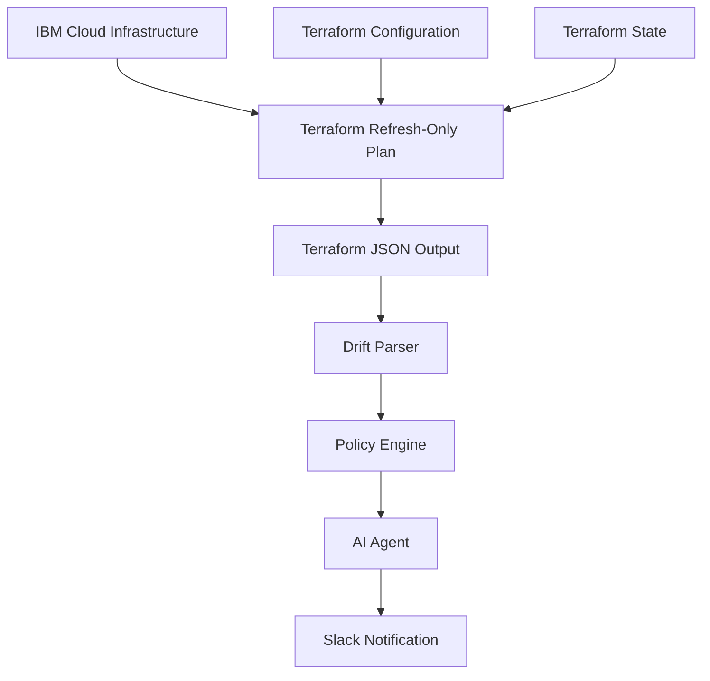
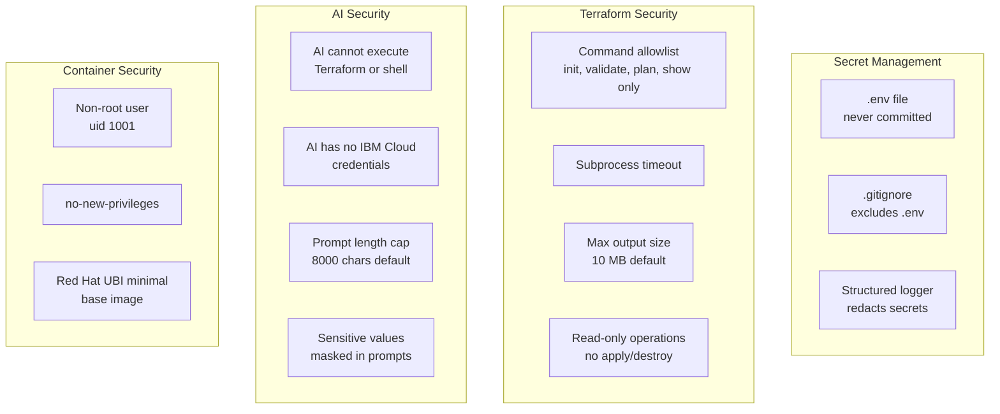
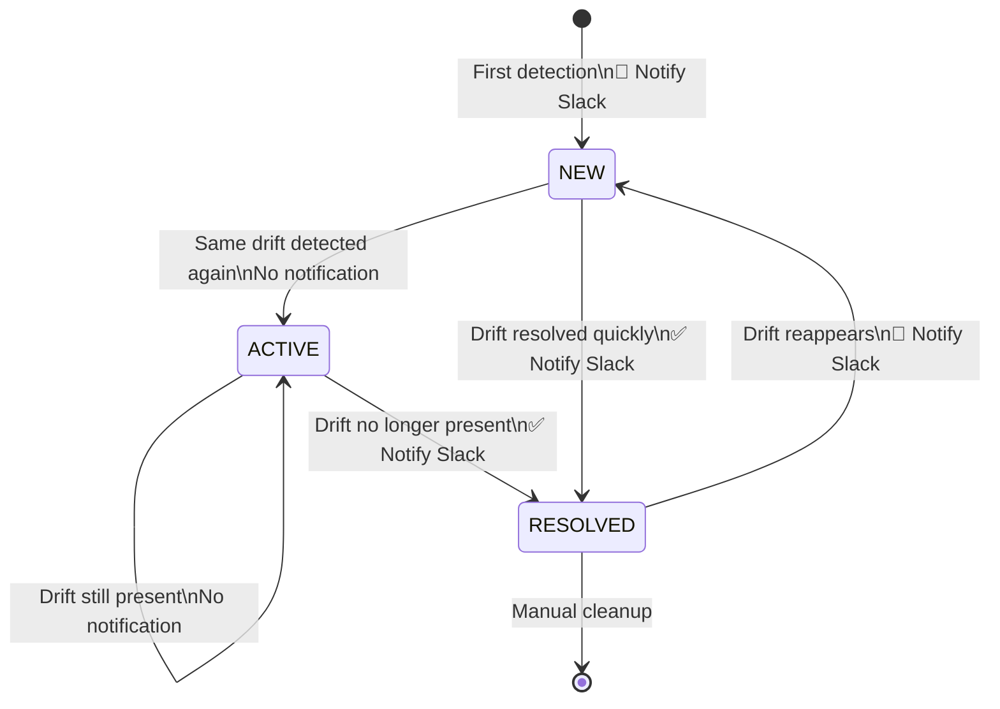
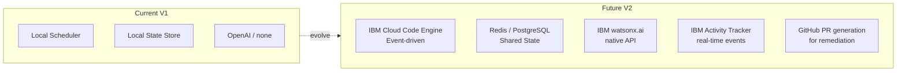

# IBM Cloud Terraform DriftGuard AI

> **Production-quality proof-of-concept** that detects manual changes to IBM Cloud infrastructure managed by Terraform, analyzes the drift with an AI agent, classifies the risk, and sends a detailed Slack notification.

---

## Table of Contents

1. [Problem Statement](#1-problem-statement)
2. [Why Terraform Drift Matters](#2-why-terraform-drift-matters)
3. [Architecture](#3-architecture)
4. [Why Terraform Detects Drift](#4-why-terraform-detects-drift)
5. [Why AI Is Used](#5-why-ai-is-used)
6. [Why AI Must Never Modify Infrastructure](#6-why-ai-must-never-modify-infrastructure)
7. [Prerequisites](#7-prerequisites)
8. [Environment Variables](#8-environment-variables)
9. [Local Setup](#9-local-setup)
10. [Terraform Deployment](#10-terraform-deployment)
11. [Manual Drift Simulation](#11-manual-drift-simulation)
12. [Running the Detector](#12-running-the-detector)
13. [Slack Setup](#13-slack-setup)
14. [AI Configuration](#14-ai-configuration)
15. [Security Architecture](#15-security-architecture)
16. [Testing](#16-testing)
17. [API Reference](#17-api-reference)
18. [Failure Scenarios](#18-failure-scenarios)
19. [Drift Lifecycle](#19-drift-lifecycle)
20. [Docker Deployment](#20-docker-deployment)
21. [Known Limitations](#21-known-limitations)
22. [Future Architecture](#22-future-architecture)

---

## 1. Problem Statement

When infrastructure is managed by Terraform, the Terraform state file becomes the **source of truth** for what the infrastructure _should_ look like. However, cloud engineers and operators often make **manual changes** directly in the IBM Cloud console, CLI, or API — without going through Terraform.

These manual changes create **drift**: a gap between what Terraform expects and what actually exists in the cloud.

Drift is dangerous because:

- It can silently introduce **security vulnerabilities** (e.g., opening a security group to `0.0.0.0/0`)
- It causes `terraform apply` to behave unexpectedly
- It creates **audit and compliance gaps**
- It is hard to detect without automated tooling

**DriftGuard AI** solves this by continuously monitoring for drift, classifying its severity, and alerting the team immediately.

---

## 2. Why Terraform Drift Matters

### Example Scenario

Terraform defines a security group rule that restricts HTTPS access to internal traffic:

```hcl
resource "ibm_is_security_group_rule" "app_https" {
  group     = ibm_is_security_group.app.id
  direction = "inbound"
  remote    = "10.0.0.0/16"   # Internal network only
  tcp {
    port_min = 443
    port_max = 443
  }
}
```

An operator manually changes this in the IBM Cloud console to allow public internet access:

```
remote = "0.0.0.0/0"   # Anyone on the internet
```

This change:
- Is not tracked in version control
- Does not trigger a code review
- May violate security policy
- Could expose the application to attacks

DriftGuard AI detects this within minutes and sends:

```
🚨 IBM Cloud Terraform Drift Detected

Environment:    Stage
Resource:       ibm_is_security_group_rule.app_https
Attribute:      remote
Expected:       10.0.0.0/16
Actual:         0.0.0.0/0
Policy Risk:    CRITICAL
AI Assessment:  CRITICAL

Impact:
Terraform indicates the security group rule now permits HTTPS traffic
from any IPv4 address. Potential impact: the service is now accessible
from the public internet.

Recommended Action:
Review this change. If unauthorized, revert through Terraform immediately.
```

---

## 3. Architecture

### High-Level Data Flow



### Detailed Pipeline

```mermaid
flowchart LR
    subgraph SCHEDULER["Scheduler (configurable interval)"]
        S[APScheduler\ntrigger]
    end

    subgraph TERRAFORM["Terraform Layer (read-only)"]
        T1[terraform init]
        T2[terraform validate]
        T3[terraform plan -refresh-only]
        T4[terraform show -json]
        T1 --> T2 --> T3 --> T4
    end

    subgraph PARSER["Drift Parser"]
        P1[Parse JSON]
        P2[Diff before vs after]
        P3[Build DriftedResource models]
        P1 --> P2 --> P3
    end

    subgraph POLICY["Deterministic Policy Engine"]
        PE1[Load rules.yaml]
        PE2[Match resource type]
        PE3[Match action]
        PE4[Match attributes]
        PE5[Match value patterns]
        PE6[Assign severity]
        PE1 --> PE2 --> PE3 --> PE4 --> PE5 --> PE6
    end

    subgraph AI["AI Analysis Agent"]
        AI1[Format structured prompt]
        AI2[Call LLM provider]
        AI3[Validate JSON response]
        AI4[Extract risk / impact / recommendation]
        AI1 --> AI2 --> AI3 --> AI4
    end

    subgraph LIFECYCLE["Lifecycle Management"]
        LC1{Event exists?}
        LC2[NEW → notify]
        LC3[ACTIVE → no notify]
        LC4[RESOLVED → notify]
        LC1 -->|No| LC2
        LC1 -->|Yes, same| LC3
        LC1 -->|Gone| LC4
    end

    subgraph SLACK["Slack Notification"]
        SL1[Build Block Kit message]
        SL2[POST to webhook]
        SL1 --> SL2
    end

    S --> T1
    T4 --> P1
    P3 --> PE1
    PE6 --> AI1
    AI4 --> LC1
    LC2 --> SL1
    LC4 --> SL1
```



### Component Separation

```mermaid
graph TB
    subgraph DETERMINISTIC["Deterministic Layer (no AI)"]
        TF[Terraform CLI]
        PARSER[Plan JSON Parser]
        POLICY[Policy Engine]
        STORE[Local State Store]
        FP[Fingerprint Engine]
    end

    subgraph AI_LAYER["AI Layer (read-only)"]
        AGENT[AI Analysis Agent]
        LLM[LLM Provider\nopenai | watsonx | none]
        PROMPTS[Prompt Templates\nwith guardrails]
    end

    subgraph ACTION["Action Layer"]
        SLACK[Slack Notifier]
    end

    DETERMINISTIC --> AI_LAYER
    AI_LAYER --> ACTION

    style DETERMINISTIC fill:#e8f4f8
    style AI_LAYER fill:#fff4e8
    style ACTION fill:#e8f8e8
```

### Project Structure

```
terraform-driftguard-ai/
│
├── app/
│   ├── main.py                 ← FastAPI entry point
│   ├── api/
│   │   └── routes.py           ← REST API endpoints
│   ├── config/
│   │   ├── settings.py         ← Pydantic Settings (all env-based)
│   │   └── logging.py          ← Structured JSON logging
│   ├── terraform/
│   │   ├── runner.py           ← CLI executor (allowlist enforced)
│   │   ├── parser.py           ← JSON diff parser
│   │   └── models.py           ← Pydantic models for plan JSON
│   ├── drift/
│   │   ├── detector.py         ← Pipeline orchestrator
│   │   ├── fingerprint.py      ← SHA-256 deduplication
│   │   └── models.py           ← Drift/Event Pydantic models
│   ├── policy/
│   │   ├── engine.py           ← Deterministic rule evaluator
│   │   └── rules.yaml          ← Configurable severity rules
│   ├── agent/
│   │   ├── agent.py            ← AI analysis orchestrator
│   │   ├── prompts.py          ← Guardrail-enforcing prompts
│   │   └── provider.py         ← LLM abstraction (openai/watsonx/none)
│   ├── notifications/
│   │   └── slack.py            ← Block Kit webhook notifier
│   ├── scheduler/
│   │   └── scheduler.py        ← APScheduler wrapper
│   └── storage/
│       ├── interface.py        ← Abstract storage interface
│       └── local.py            ← Local JSON file store
│
├── terraform/
│   ├── main.tf                 ← Demo VPC + security group
│   ├── variables.tf
│   ├── outputs.tf
│   └── versions.tf
│
├── tests/                      ← 111 tests, no IBM Cloud required
├── scripts/
│   └── run_drift_check.sh
│
├── .env.example
├── requirements.txt
├── Dockerfile
├── docker-compose.yml
└── README.md
```

---

## 4. Why Terraform Detects Drift

Terraform uses `terraform plan -refresh-only` to:

1. **Read the current Terraform state** (what Terraform last applied)
2. **Query the actual cloud resources** via the IBM Cloud provider API
3. **Compare the two** and produce a plan showing what changed

This is the **authoritative, deterministic** source of truth for drift detection. The AI is never consulted to determine _whether_ drift exists — only to _explain_ and _classify_ the drift that Terraform has already found.

**DriftGuard AI never calls `terraform apply`**. The entire pipeline is read-only.

---

## 5. Why AI Is Used

Terraform tells you _what_ changed. AI tells you _why it matters_.

| Terraform (deterministic) | AI Agent |
|--------------------------|----------|
| `remote` changed from `10.0.0.0/16` to `0.0.0.0/0` | This opens HTTPS access to the public internet |
| `profile` changed from `bx2-2x8` to `bx2-4x16` | Instance was resized, likely for capacity |
| `encryption_key` changed | Encryption key rotation or unauthorized change |

AI provides:
- **Human-readable explanations** that an on-call engineer can act on immediately
- **Risk assessment** that accounts for context (resource type, change type, environment)
- **Recommended actions** specific to the change
- **Likely reason** (without inventing information)

---

## 6. Why AI Must Never Modify Infrastructure

The AI layer has **zero** ability to:

- Execute `terraform apply`
- Call IBM Cloud APIs directly
- Access IBM Cloud credentials
- Read or write to the filesystem beyond what is explicitly passed
- Execute shell commands

This is enforced by design:
- The AI agent receives only **structured data** (dicts/strings)
- The AI agent returns only **structured analysis** (JSON)
- The Terraform runner enforces a strict **command allowlist**
- These are separate, non-overlapping code paths

---

## 7. Prerequisites

| Requirement | Version | Notes |
|-------------|---------|-------|
| Python | 3.10+ | 3.11+ recommended |
| Terraform CLI | 1.5+ | `brew install terraform` or HashiCorp releases |
| IBM Cloud account | Stage/Dev | No enterprise services required |
| `IBMCLOUD_API_KEY` | — | IBM Cloud IAM API key |
| Slack Incoming Webhook | — | Optional but recommended |
| OpenAI API key | — | Optional; set `LLM_PROVIDER=none` to disable |

---

## 8. Environment Variables

Copy `.env.example` to `.env` and configure:

```bash
cp .env.example .env
```

### Required

| Variable | Description |
|----------|-------------|
| `TERRAFORM_WORKING_DIR` | Path to Terraform configuration (default: `./terraform`) |

### IBM Cloud (for real drift detection)

| Variable | Description |
|----------|-------------|
| `IBMCLOUD_API_KEY` | IBM Cloud IAM API key (used by Terraform provider) |
| `IBMCLOUD_REGION` | IBM Cloud region (e.g., `us-south`) |

### Optional

| Variable | Default | Description |
|----------|---------|-------------|
| `ENVIRONMENT` | `development` | Environment label in notifications |
| `DRIFT_CHECK_INTERVAL_SECONDS` | `300` | Polling interval (minimum 30) |
| `DRIFT_NOTIFY_ON_RESOLVE` | `true` | Send notification when drift resolves |
| `LLM_PROVIDER` | `none` | `openai`, `watsonx`, or `none` |
| `LLM_API_KEY` | — | API key for LLM provider |
| `LLM_MODEL` | `gpt-4o-mini` | Model identifier |
| `SLACK_WEBHOOK_URL` | — | Slack Incoming Webhook URL |
| `SLACK_ENABLED` | `true` | Master on/off switch |
| `LOG_FORMAT` | `json` | `json` or `text` |

---

## 9. Local Setup

```bash
# 1. Clone the repository
git clone <your-repo-url>
cd terraform-driftguard-ai

# 2. Install Python dependencies
pip install -r requirements.txt

# 3. Configure environment
cp .env.example .env
# Edit .env and fill in your values

# 4. Run the tests (no IBM Cloud required)
python -m pytest -v

# 5. Start the application
python -m uvicorn app.main:app --host 127.0.0.1 --port 8080

# 6. Check health
curl http://127.0.0.1:8080/health
```

---

## 10. Terraform Deployment

### Set up IBM Cloud credentials

```bash
export IBMCLOUD_API_KEY="your-ibm-cloud-api-key"
export IBMCLOUD_REGION="us-south"
```

### Initialize and apply

```bash
cd terraform

# Copy and customize variables
cp terraform.tfvars.example terraform.tfvars

# Initialize Terraform
terraform init

# Preview what will be created
terraform plan

# Apply (creates VPC, subnet, security group, security group rules)
terraform apply
```

> **Cost**: The demo resources (VPC, security groups) incur minimal to no charge in IBM Cloud. No VSIs, databases, or Kubernetes clusters are created.

### Configure DriftGuard to monitor your Terraform

```bash
# In .env:
TERRAFORM_WORKING_DIR=./terraform
ENVIRONMENT=stage
```

---

## 11. Manual Drift Simulation

This is the demo scenario that DriftGuard is designed to detect.

### Step 1: Verify expected state

```bash
terraform show | grep remote
# Expected: remote = "10.0.0.0/16"
```

### Step 2: Manually change the security group rule

1. Log in to [IBM Cloud Console](https://cloud.ibm.com)
2. Navigate to **VPC Infrastructure → Security Groups**
3. Find the security group named `driftguard-demo-app-sg`
4. Click the HTTPS inbound rule (TCP 443)
5. Change **Source** from `10.0.0.0/16` to `0.0.0.0/0`
6. Save the change

### Step 3: Verify the drift exists

```bash
terraform plan -refresh-only
# Should show: ~ remote = "10.0.0.0/16" → "0.0.0.0/0"
```

### Step 4: Trigger DriftGuard detection

```bash
# Via API (application must be running)
curl -X POST http://127.0.0.1:8080/api/drift/check

# Or run the script
./scripts/run_drift_check.sh
```

### Step 5: Observe the Slack notification

```
🚨 NEW DRIFT — IBM Cloud Infrastructure

Environment:     Stage
Resource:        ibm_is_security_group_rule.app_https
Resource Type:   ibm_is_security_group_rule
Action:          UPDATE

Changed Attributes:
• remote:
  Expected: 10.0.0.0/16
  Actual:   0.0.0.0/0

Policy Risk:    🔴 CRITICAL
AI Assessment:  CRITICAL

AI Summary:
Terraform indicates the inbound HTTPS security group rule remote
CIDR was changed from 10.0.0.0/16 to 0.0.0.0/0.

Potential Impact:
Potential impact: HTTPS traffic is now permitted from any IPv4 address
on the public internet.

Recommended Action:
Review the change. If unauthorized, revert the security group rule
through Terraform to restore the expected configuration.
```

### Step 6: Resolve the drift

```bash
# Revert through Terraform (NEVER let DriftGuard do this automatically)
terraform apply
```

### Step 7: Confirm resolution

```bash
curl -X POST http://127.0.0.1:8080/api/drift/check
# Result: drift_detected: false
```

Slack will receive:

```
✅ DRIFT RESOLVED — Infrastructure matches Terraform state
Resource: ibm_is_security_group_rule.app_https
Attribute: remote
```

---

## 12. Running the Detector

### Via API (recommended)

```bash
# Start the application
python -m uvicorn app.main:app --host 127.0.0.1 --port 8080

# Trigger a check
curl -X POST http://127.0.0.1:8080/api/drift/check

# View latest result
curl http://127.0.0.1:8080/api/drift

# View history
curl http://127.0.0.1:8080/api/drift/history

# Test Slack
curl -X POST http://127.0.0.1:8080/api/test/slack
```

### Via scheduler

The scheduler runs automatically when the application starts.
Configure the interval:

```bash
DRIFT_CHECK_INTERVAL_SECONDS=300  # Run every 5 minutes
```

---

## 13. Slack Setup

1. Create a Slack app at [api.slack.com/apps](https://api.slack.com/apps)
2. Enable **Incoming Webhooks**
3. Create a webhook for your desired channel
4. Copy the webhook URL
5. Add to `.env`:

```bash
SLACK_WEBHOOK_URL=https://hooks.slack.com/services/YOUR/WEBHOOK/URL
SLACK_ENABLED=true
```

6. Test the connection:

```bash
curl -X POST http://127.0.0.1:8080/api/test/slack
```

---

## 14. AI Configuration

### Disable AI (use deterministic fallback)

```bash
LLM_PROVIDER=none
```

When disabled, notifications are still sent but without AI analysis:

```
⚠️ Terraform drift detected. AI analysis unavailable — review changes manually.
```

### OpenAI

```bash
LLM_PROVIDER=openai
LLM_API_KEY=sk-...
LLM_API_BASE_URL=https://api.openai.com/v1
LLM_MODEL=gpt-4o-mini
```

### IBM watsonx.ai

```bash
LLM_PROVIDER=watsonx
LLM_API_KEY=<IBM Cloud IAM API Key>
LLM_API_BASE_URL=https://us-south.ml.cloud.ibm.com/ml/v1
LLM_MODEL=ibm/granite-3-3-8b-instruct
```

### AI Guardrails

The AI agent is constrained by prompt engineering to:

- ✅ Report only what Terraform shows
- ✅ Use cautious language (`"Terraform indicates..."`, `"Potential impact..."`)
- ✅ Return strict JSON only
- ❌ Never invent actors, timestamps, resource IDs
- ❌ Never claim unauthorized activity without evidence
- ❌ Never execute commands
- ❌ Never access IBM Cloud

If the AI returns invalid JSON or times out, a deterministic fallback is used and the drift event is **never lost**.

---

## 15. Security Architecture



| Security Control | Implementation |
|-----------------|----------------|
| Secrets in env only | `.env` file, `.gitignore` excludes it |
| Never log secrets | `structlog` processor redacts 8 known secret fields |
| Terraform allowlist | Blocks `apply`, `destroy`, `taint`, `state rm`, `import` |
| Subprocess timeout | Configurable (default 5 minutes) |
| Max output size | Configurable (default 10 MB) |
| AI isolation | AI receives structured data only, no shell/filesystem access |
| Sensitive masking | Before/after values marked `is_sensitive` are replaced with `[sensitive]` |
| Non-root Docker | UID 1001, `no-new-privileges` |
| Red Hat base image | `registry.redhat.io/ubi9/python-312-minimal` |

---

## 16. Testing

```bash
# Run all tests (111 tests, no IBM Cloud required)
python -m pytest -v

# With coverage
python -m pytest --cov=app --cov-report=term-missing

# Run specific phase
python -m pytest tests/test_terraform_parser.py -v
python -m pytest tests/test_policy_engine.py -v
python -m pytest tests/test_agent.py -v
python -m pytest tests/test_slack.py -v
python -m pytest tests/test_drift_detector.py -v
```

### Test Coverage

| Test File | Scenarios Covered |
|-----------|-------------------|
| `test_phase1_structure.py` | Package imports, models, settings |
| `test_terraform_runner.py` | Command allowlist, subprocess mocking, timeout, output limits |
| `test_terraform_parser.py` | No drift, single drift, multi drift, replace, delete, sensitive, create |
| `test_fingerprint.py` | SHA-256 determinism, uniqueness, store CRUD |
| `test_policy_engine.py` | CRITICAL/HIGH/MEDIUM/LOW rules, public CIDR, IAM, tags |
| `test_agent.py` | NoOp provider, AI success, fallback on failure, prompt masking |
| `test_slack.py` | Success, failure, missing webhook, sensitive masking, disabled |
| `test_drift_detector.py` | Full pipeline, deduplication, resolution, Terraform failure |

---

## 17. API Reference

| Method | Path | Description |
|--------|------|-------------|
| `GET` | `/health` | Application liveness probe |
| `GET` | `/api/drift` | Latest drift detection result |
| `POST` | `/api/drift/check` | Manually trigger a drift check |
| `GET` | `/api/drift/history` | Recent drift events from state store |
| `POST` | `/api/test/slack` | Send a test Slack notification |

Interactive docs: `http://127.0.0.1:8080/docs`

---

## 18. Failure Scenarios

| Scenario | Behavior |
|----------|----------|
| Terraform CLI not installed | `TerraformNotFoundError` captured in report |
| `terraform init` fails | Error in report, no notification |
| `terraform plan` fails | Error in report, no notification |
| IBM Cloud auth expired | Terraform plan fails, error captured |
| AI API timeout | Deterministic fallback notification sent |
| AI returns invalid JSON | Deterministic fallback notification sent |
| Slack webhook fails | Logged; drift event preserved in store |
| Slack not configured | Silent skip; drift still stored |
| Duplicate drift | Same fingerprint → no second notification |
| Large Terraform output | Truncated at `TERRAFORM_MAX_OUTPUT_BYTES` |

---

## 19. Drift Lifecycle



---

## 20. Docker Deployment

```bash
# Build
docker build -t driftguard-ai .

# Run (with .env file)
docker run \
  --env-file .env \
  -p 127.0.0.1:8080:8080 \
  -v driftguard-state:/app/.driftguard/state \
  driftguard-ai

# Docker Compose
cp .env.example .env
docker-compose up
```

### IBM Cloud Code Engine (future)

```bash
# Build and push to IBM Cloud Container Registry
ibmcloud cr build --tag us.icr.io/your-namespace/driftguard-ai:latest .

# Deploy to Code Engine
ibmcloud ce application create \
  --name driftguard-ai \
  --image us.icr.io/your-namespace/driftguard-ai:latest \
  --env-from-secret driftguard-secrets \
  --min-scale 1 \
  --max-scale 1
```

---

## 21. Known Limitations

- **V1 is read-only**: The system never modifies infrastructure. All remediation is manual.
- **Local state only**: Drift fingerprints are stored as local JSON files. Not suitable for multi-instance deployment without shared storage.
- **No real-time streaming**: Uses polling interval (default 5 min), not event-driven.
- **Single workspace**: Monitors one Terraform workspace at a time.
- **No historical analytics**: No time-series storage of drift history.
- **watsonx.ai**: Uses OpenAI-compatible API format. Native watsonx API not yet implemented.

---

## 22. Future Architecture

### Near-term



### Planned integrations

| Integration | Purpose | Phase |
|------------|---------|-------|
| IBM Activity Tracker | Real-time change events | V2 |
| IBM Cloud Schematics | Workspace-aware drift | V2 |
| Redis state store | Multi-instance dedup | V2 |
| PostgreSQL | Historical drift analytics | V2 |
| GitHub PR creation | Automated revert PRs | V3 |
| IBM watsonx.ai native | IBM-native AI | V2 |
| Multiple workspaces | Multi-account monitoring | V2 |
| Human approval workflow | Gate remediation | V3 |
| RAG over IaC docs | Context-aware AI | V3 |

---

## Flow


## Slack notification


